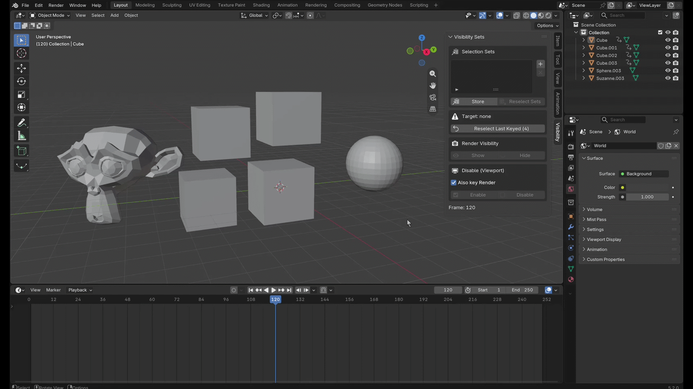
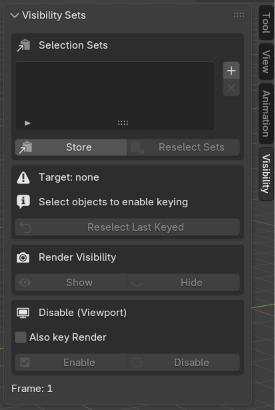
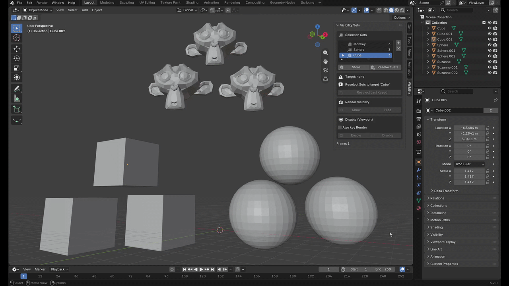
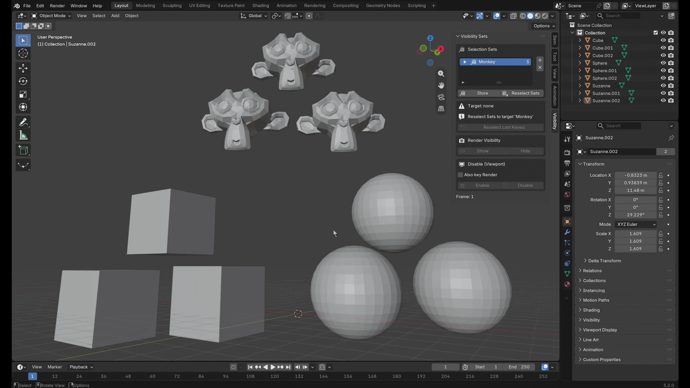
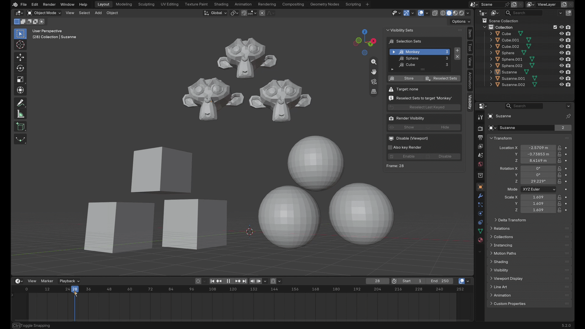

# Visibility Sets

**Bulk-select objects that are already disabled, and keyframe their visibility in one click.**

## The problem

Animating objects popping in and out is one of the most common things you do in Blender, yet it is very tedious. 

The usual move is to key **Disable in Viewports** (the monitor icon) and **Disable in Renders** (the camera icon). That works fine until you actually disable something. A disabled object **can't be selected in the viewport at all.** Blender clears its selection on the next redraw, so you can't box-select it, you can't Shift-click it, and `select_set(True)` silently does nothing.

So the moment you need those objects back, to key them on again a few frames later, Blender has no way to give them back to you as a group. You end up digging through the Outliner, finding each object, hovering over its icon and pressing `I`, **one object at a time**. With 5 objects that's annoying. With 50 debris pieces, it's a whole evening.

**Visibility Sets fixes this:**

- **One-click visibility keys**: Show / Hide (render) and Enable / Disable (viewport) on every selected object at the current frame.
- **Get disabled objects back instantly**: *Reselect Last Keyed* re-selects whatever you just keyed, even after it's been disabled.
- **Named selection sets**: save groups of objects in your `.blend`, and recall them later, disabled or not.
- **Nothing gets keyed by accident**: only a real selection is ever a target. No hidden "active object" fallback.

---

## Hiding and showing objects

### Where to find it

- **3D Viewport → Sidebar (`N`) → Visibility** tab
- **3D Viewport → Object menu → Visibility Sets** (all the main actions, menu form)

The panel is split into four boxes, top to bottom: **Selection Sets**, **Target**, **Render Visibility**, and **Disable (Viewport)**. The bottom two do the keying. Selection Sets is covered [further down](#selection-sets).

### Keying visibility

Select your objects (in the viewport *or* the Outliner), go to the frame you want, and press a button:

| Button | What it keys | Value |
| --- | --- | --- |
| **Render Visibility → Show** | `hide_render` | Visible in renders |
| **Render Visibility → Hide** | `hide_render` | Hidden in renders |
| **Disable (Viewport) → Enable** | `hide_viewport` | Enabled in viewports |
| **Disable (Viewport) → Disable** | `hide_viewport` | Disabled in viewports |

Every selected object gets keyed at the current frame. Keys use **Constant** interpolation, so visibility snaps on and off instead of ramping.

**Also key Render**: turn this on and Enable / Disable will key render visibility at the same time. Most of the time this is what you want. One click and the object is gone from both the viewport and the final render.

The **Target** box always shows how many objects are about to be keyed. If it says *Target: none*, the buttons are greyed out. Nothing will be keyed until you select something.

> **Note:** This addon keys **Disable in Viewports** (the monitor icon), not the eye icon. The eye (*Hide in Viewport*) is per view layer and can't be animated. If you don't see the monitor icon in your Outliner, turn it on under the Outliner's **Filter → Restriction Toggles**.

(docs/monitor_toggle.png)

### Bringing them back: Reselect Last Keyed

Every time you press Show / Hide / Enable / Disable, the addon remembers exactly which objects it keyed. **Reselect Last Keyed** (in the Target box) selects them again, disabled or not. The number on the button tells you how many objects it will bring back.

That's the whole demo at the top of this page, and you don't need to set anything up:

1. Frame 1 → select your objects → **Disable**
2. Jump to frame 50 → **Reselect Last Keyed**
3. **Enable**

Done. The objects are off from frame 1 and pop in at frame 50.

### Keyboard shortcuts

No shortcuts are assigned by default, so nothing clashes with your existing keymap. To add your own:

- **Right-click any button → Assign Shortcut**, or
- **Edit → Preferences → Keymap → Object Mode**, where every action is listed by name (*Render: Hide*, *Viewport: Disable*, *Reselect Last Keyed*, …) with an empty key field ready to fill in.

---

## Selection Sets

Reselect Last Keyed only remembers the **most recent** batch. Real scenes have several groups that come and go at different times, and once they're all disabled, you still need a way to grab exactly the group you want.

That's what **Selection Sets** are for. Save a group once, and one click selects it again, whether it's visible or disabled.

### Setting up a set

1. Click **+** to add a set. Double-click its name to rename it.
2. Select the objects and press **Store**. This replaces whatever was in the set.
3. Repeat for each group.

From then on, pick a set in the list and press **Reselect Sets** to select everything in it again, **even if they're all disabled**. Then key them like any other selection.

Sets are saved inside the `.blend` file. They store references to the objects themselves, not their names, so **renaming an object doesn't break a set**. Deleted objects are removed from sets automatically.

### Editing a set

Click the arrow next to the active set to expand its object list:

- **Click an object's name** to select just that one (**Shift-click** to add it to the selection). The highlighted rows show what's currently selected, and the eye icon shows whether each object is currently disabled.
- **X** removes an object from the set. The object itself isn't touched.
- **Add Selected** adds the current selection to the set, skipping objects already in it.
- Use the search field and sort buttons at the bottom of the list to find objects in large sets.

You can also build a set from the **Outliner**. Disabled objects can still be selected there (the rows stay selectable even when the objects aren't), and Visibility Sets reads the Outliner selection. Ctrl/Shift-select rows there and press **Store** or **Add Selected**. The keying buttons read it too.

### What "unblock" means

Blender won't let a disabled object be selected. So when you reselect a set (or the last keyed objects), the addon briefly **turns off "Disable in Viewports" on those objects, without inserting a keyframe**, so they can be selected.

This is temporary by design:

- Press **Enable** → that state gets committed as a keyframe (this is usually what you're about to do anyway).
- Change frames → the animation drives the objects straight back to disabled.
- Press **Ctrl+Z** → reverts it.

If you'd rather only select objects that are already visible, open the **Adjust Last Operation** panel (bottom-left, or `F9`) right after reselecting and uncheck **Unblock Disabled**.

If you see a warning like *"3 unreachable (collection hidden or excluded)"*, those objects live in a collection that's hidden or excluded from the view layer. Enable the collection first, then reselect.

---

## Full workflow

Putting it together: three groups of objects, each with its own set, keyed in and out on their own frames. For each group: pick its set → **Reselect Sets** → **Enable** or **Disable** on the frame you want.

---

## Installation

Requires **Blender 4.2** or newer.

1. Download the latest `.zip` from [Releases](https://github.com/Spongizer/visibility-sets/releases/latest).
2. Drag the `.zip` into the Blender window and click **Install**.
   *(Or: **Edit → Preferences → Get Extensions → ⌄ menu (top right) → Install from Disk…**)*
3. Press `N` in the 3D Viewport and open the **Visibility** tab.

---

## License

GPL-3.0-or-later © 2026 Sponge

---

**A note on this repository:** Visibility Sets was developed locally, without Git. This repository was created at release time to publish the add-on and make the source available for review, so the commit history is short and doesn't reflect how the project was built. Design and performance notes from development are in [`docs/performance-notes.md`](docs/performance-notes.md).
